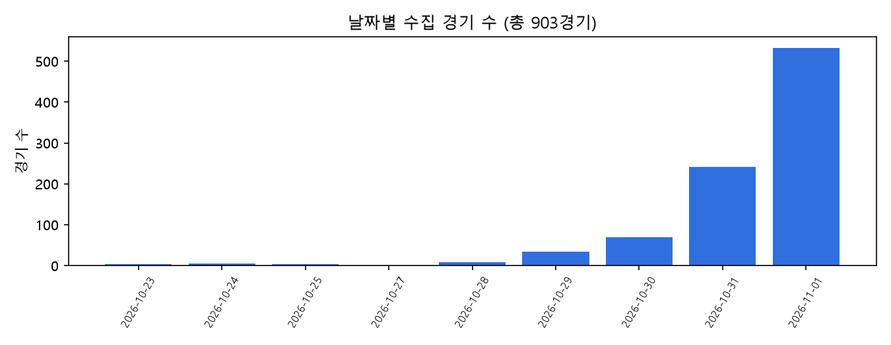
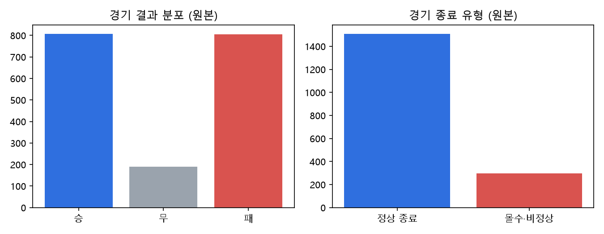
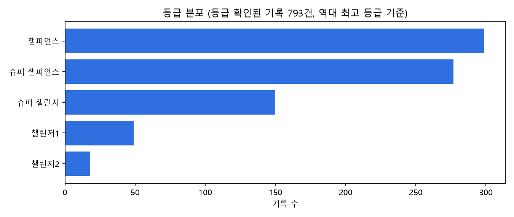
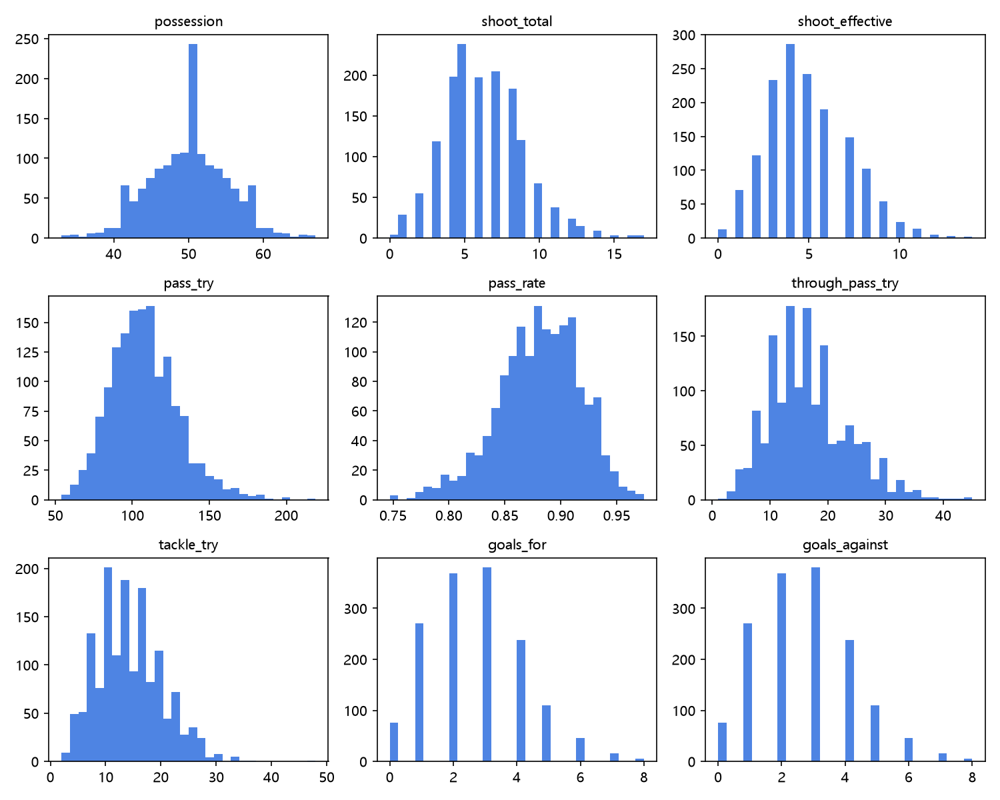
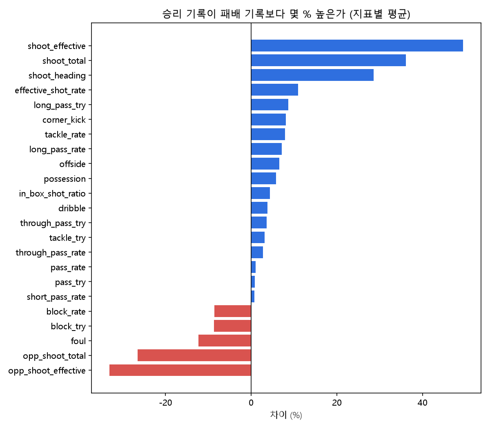
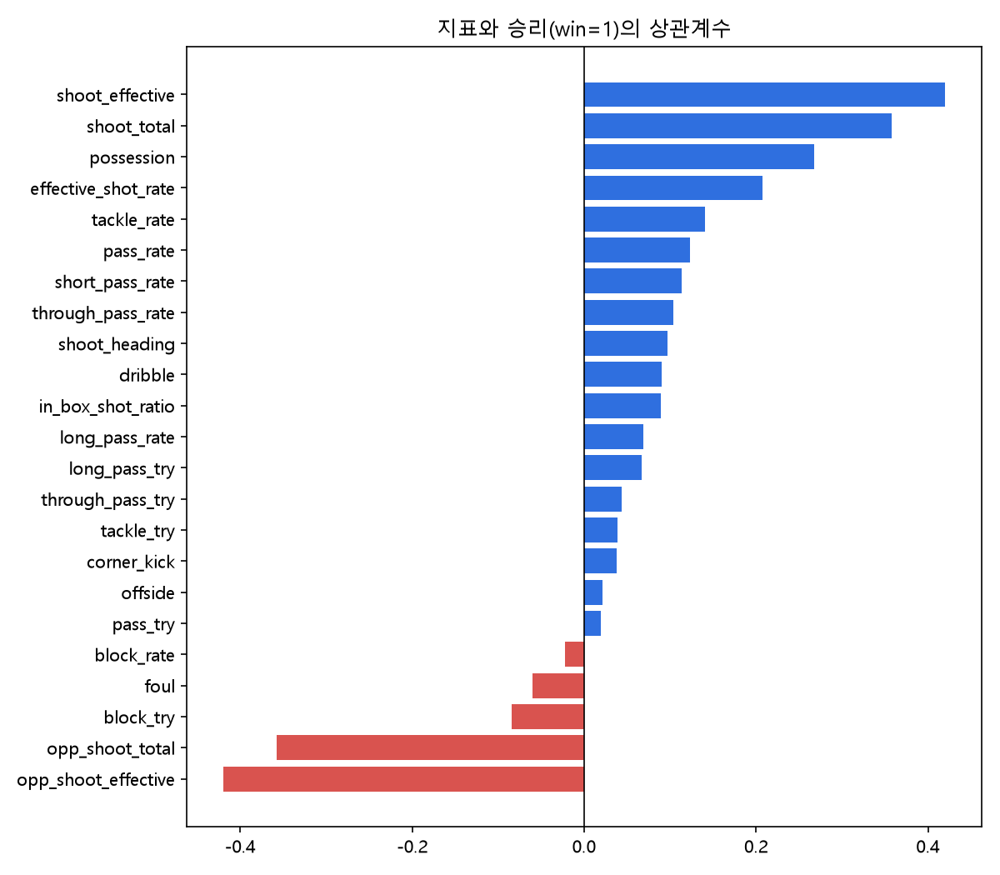
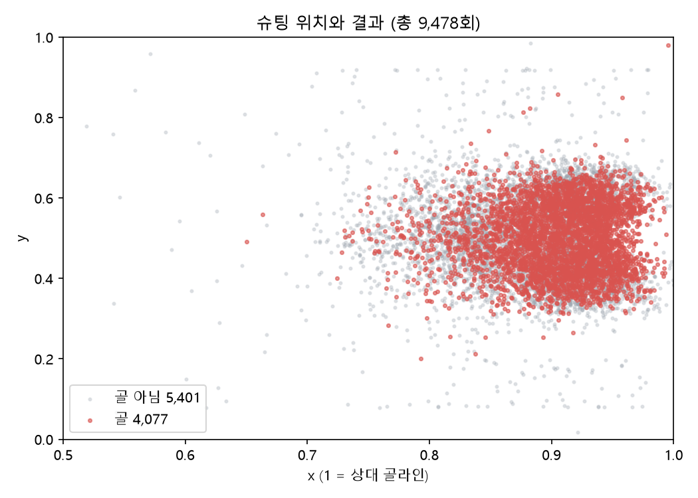
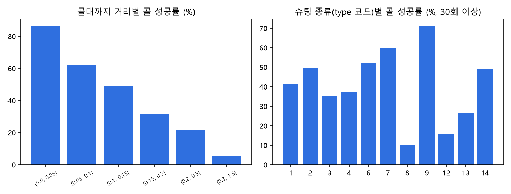

git reset --soft origin/main# FC 에이전트: 내 등급 기준으로 보는 FC 온라인 경기 분석

> 넥슨 Open API로 FC 온라인 공식경기를 수집해 **승패를 가르는 플레이 지표**와 **골이 되는 슈팅의 조건**을 찾는 데이터 분석 프로젝트

- 배포 서비스: https://fc-agent.onrender.com
- 수집일: 2026-11-02 (경기 날짜 범위는 [그래프 01](docs/figures/01_matches_by_date.png) 참고)

---

## 1. 문제 정의

FC 온라인 전적 사이트(FC.GG, QWZD, TOTS.GG)는 **내 기록**이나 **랭커 기준**으로만 비교한다. 예를 들어 FC.GG는 "랭커 대비 로빙스루패스 시도 783%"처럼 최상위 유저와 비교하는데, 이는 실력 차이보다 플레이 스타일 차이에 가깝다. 대부분의 유저에게 필요한 답은 **"내 등급에서 이기려면 무엇이 중요한가"**이지만, 이 질문에 데이터로 답하는 서비스는 없다.

이 프로젝트는 같은 등급대 유저들의 공식경기를 수집해 두 가지 질문에 답한다.

1. **경기 단위:** 승리한 경기와 패배한 경기를 가장 잘 구분하는 플레이 지표는 무엇인가?
2. **슈팅 단위:** 어떤 위치와 종류의 슈팅이 골이 되는가?

## 2. 결론에 대한 가설

| 번호 | 가설 | 검증 방법 |
|---|---|---|
| H1 | 승패를 가장 잘 구분하는 지표는 **내 유효슈팅**과 **상대에게 허용한 유효슈팅**이다 | 승패 라벨과 지표의 상관계수, 승리·패배 평균 비교 |
| H2 | **점유율**은 승패와의 관련이 약하다 | 점유율과 승패의 상관계수 |
| H3 | 등급이 높을수록 유효슈팅 비율과 패스 성공률이 높다 | 등급별 지표 평균 비교 (데이터 추가 수집 후) |
| H4 | 골대에 가까운 슈팅일수록 골 확률이 높고, 슈팅 종류에 따라 성공률이 다르다 | 거리 구간별·슈팅 종류별 골 성공률 |

가설이 맞다면, 서비스는 점유율보다 **유효슈팅을 만들고 허용하지 않는 지표**와 **슈팅 위치**를 중심으로 "내 등급 평균 대비 나의 위치"를 보여줘야 한다.

## 3. 데이터 수집

### 3-1. 수집 방법

넥슨 Open API에는 전체 경기 목록이나 등급별 유저 목록을 주는 API가 없다. 경기 목록은 **특정 유저를 거쳐서만** 받을 수 있어서, 한 유저에서 시작해 상대 유저를 따라가는 **눈덩이 방식**으로 수집했다. FC 온라인은 비슷한 등급끼리 매칭되므로, 사전 테스트에서 따라간 유저의 82%가 시작 유저와 ±1등급 이내였다.

| 사용 API | 용도 | 2026-11-02 호출 수 |
|---|---|---|
| `/fconline/v1/match-detail` | 경기 상세 기록 (양쪽 유저 지표 + 슈팅 상세) | 903 |
| `/fconline/v1/user/match` | 유저의 최근 공식경기 ID 목록 (유저당 20경기) | 48 |
| `/fconline/v1/user/maxdivision` | 유저의 공식경기 최고 등급 | 48 |
| `/fconline/v1/id` | 시작 유저 닉네임 → 유저 ID | 1 |

- 대상: 공식경기 (matchtype 50)
- 저장: SQLite (`data/fc_dataset.db`), 경기 원본 JSON을 압축 저장
- 코드: [`collect_bulk.py`](collect_bulk.py) (중단 후 재실행하면 이어서 수집)

**수집 제약:** 개발 단계 API 키는 **하루 1,000회**로 호출이 제한된다 (넥슨 Open API 통계 화면에서 확인). 경기 상세 1건에 호출 1회가 필요하므로 하루 약 900경기가 상한이다.

### 3-2. 확보한 데이터의 양

| 단계 | 경기 단위 데이터 | 슈팅 단위 데이터 |
|---|---|---|
| 원본 | 유저 기록 **1,806건** (903경기 × 2명) | 슈팅 기록 **10,849건** |
| 전처리 후 | 유저 기록 **1,510건** | 슈팅 기록 **9,478건** |
| 라벨링 학습 데이터셋 | **1,320건** (`win`) | **9,478건** (`goal`) |

**권장 기준 대비:** 슈팅 데이터셋은 학습 데이터 2,000건 기준을 충족한다. 전처리 후 25,000건 기준은 일일 호출 한도 때문에 아직 미달이며, 매일 이어서 수집하고 있다. 하루 약 900경기(유저 기록 약 1,500건, 슈팅 약 10,000건)씩 늘어나므로 **슈팅 데이터는 약 2일 뒤, 경기 단위 데이터는 약 2주 뒤 25,000건**에 도달할 예정이다. 넥슨 Open API의 서비스 단계 전환을 신청하면 한도를 늘릴 수 있다.

### 3-3. 전처리

**경기 단위 (유저 기록)**

| 단계 | 제거 | 남은 건수 |
|---|---|---|
| 원본 | - | 1,806 |
| 중복 기록 제거 | 0 | 1,806 |
| 몰수·비정상 종료 경기 제거 (matchEndType ≠ 0) | **296** | 1,510 |
| 상대 기록이 없는 경기 제거 | 0 | 1,510 |
| 결과 값이 없거나 이상한 기록 제거 | 0 | 1,510 |
| 패스 시도 0회 기록 제거 | 0 | 1,510 |

**슈팅 단위**

| 단계 | 제거 | 남은 건수 |
|---|---|---|
| 원본 | - | 10,849 |
| 몰수·비정상 종료 경기의 슈팅 제거 | **1,367** | 9,482 |
| 좌표가 없거나 0~1 범위를 벗어난 슈팅 제거 | 4 | 9,478 |
| 결과 값이 1·2·3이 아닌 슈팅 제거 | 0 | 9,478 |

추가로 비율 지표(패스 성공률, 스루패스 성공률, 유효슈팅 비율, 박스 안 슈팅 비율, 태클·블락 성공률)와 슈팅의 **골대까지 거리·각도**를 계산했다.

## 4. 원본 데이터 EDA

코드: [`eda.py`](eda.py) · 기술통계 표: [`docs/eda_summary.md`](docs/eda_summary.md)

### 4-1. 수집 기간과 경기 결과





- **몰수·비정상 종료 경기가 전체의 16.4%**(1,806건 중 296건)다. 이 경기들은 상대 기록이 비어 있거나 플레이가 끝까지 진행되지 않아, 제거하지 않으면 지표 평균이 왜곡된다.
- 전처리 후 무승부는 190건(12.6%)이다.

### 4-2. 등급 분포



시작 유저(슈퍼 챌린지)에서 출발했기 때문에 **슈퍼 챌린지~챔피언스 근처에 데이터가 몰려 있다.** 등급을 확인한 유저는 47명이라, 등급별 비교(H3)는 데이터를 더 모은 뒤 검증한다.

### 4-3. 주요 지표 분포



### 4-4. 승리 vs 패배 (경기 단위)





| 지표 | 승리와의 상관계수 (약) | 승리 기록이 패배 기록보다 (약) |
|---|---|---|
| 내 유효슈팅 수 | **+0.42** | +49% |
| 상대 유효슈팅 수 | **-0.42** | -33% |
| 내 슈팅 수 | +0.36 | +36% |
| 상대 슈팅 수 | -0.36 | -26% |
| 점유율 | +0.27 | +6% |
| 유효슈팅 비율 | +0.21 | +11% |
| 박스 안 슈팅 비율 | +0.09 | +5% |

- **H1 지지:** 승패와 가장 강하게 연결된 지표는 **내 유효슈팅(+0.42)**과 **상대 유효슈팅(-0.42)**이다. 슈팅을 "얼마나 많이 정확하게 만들고, 얼마나 허용하지 않는가"가 승패를 가장 잘 구분한다.
- **H2 기각:** 점유율의 상관계수는 +0.27로 세 번째로 크다. 반면 패스 시도 수는 거의 0이라, **공을 오래 돌리는 것보다 점유하며 기회를 만드는 것**이 중요해 보인다.
- **해석 주의:** 블락 시도가 많을수록 오히려 승률이 낮다(-0.08). 수비를 잘해서가 아니라 **공격을 많이 당해서 블락할 일이 많아진 것**으로, 상관관계를 인과로 읽으면 안 된다.

### 4-5. 슈팅 위치와 골 (슈팅 단위)





| 골대까지 거리 (필드 비율) | 골 성공률 (약) |
|---|---|
| 0 ~ 0.05 | 87% |
| 0.05 ~ 0.10 | 62% |
| 0.10 ~ 0.15 | 49% |
| 0.15 ~ 0.20 | 32% |
| 0.20 ~ 0.30 | 22% |
| 0.30 이상 | 5% |

- **H4 지지:** 거리가 멀어질수록 골 성공률이 87%에서 5%까지 단계적으로 떨어진다. 슈팅은 x 0.85~0.97, y 0.35~0.65(박스 정면)에 몰려 있다.
- 전체 슈팅의 **43%가 골**로, 실제 축구보다 훨씬 높다. FC 온라인에서는 슈팅 수보다 **어디서 차는가**가 결과를 크게 좌우한다.
- 슈팅 종류별 성공률은 코드 9(약 71%)가 가장 높고 코드 8(약 10%)이 가장 낮다. 넥슨 문서 기준으로 9는 페널티킥, 8은 프리킥으로 추정되며, 나머지 코드의 이름은 확인이 필요하다.

**경기 단위와 슈팅 단위를 합친 결론:** 박스 안 슈팅 *비율*은 경기 승패와 상관이 약하지만(+0.09), 슈팅 *하나하나*로 보면 거리가 골 확률을 강하게 결정한다. 즉 **가까운 위치에서 유효슈팅을 많이 만드는 것**이 승리로 이어진다.

## 5. 데이터 라벨링

### 5-1. 라벨 정의

| 데이터셋 | 라벨 | 값 | 정의 | 원본 필드 |
|---|---|---|---|---|
| 경기 단위 | `win` | 1 / 0 | 해당 유저가 그 경기에서 **승리하면 1, 패배하면 0** | `matchDetail.matchResult` ("승" / "패") |
| 슈팅 단위 | `goal` | 1 / 0 | 그 슈팅이 **골이면 1, 아니면 0** | `shootDetail.result` (3 = 골, 1 = 유효슛, 2 = 무효슛) |
| 공통 (보조) | `tier_group` | 등급 이름 | 슈팅한 유저의 공식경기 **역대 최고 등급** (숫자 단계 제거) | `/user/maxdivision` |

**라벨링 규칙**

- 무승부는 승패 어느 쪽도 아니므로 `win` 데이터셋에서 제외한다 (190건).
- 몰수·비정상 종료 경기는 실제 플레이 결과가 아니므로 두 데이터셋 모두에서 제외한다.
- **득점·실점·평균 평점은 `win` 데이터셋의 피처에서 제외한다.** 득점과 실점은 승패를 그대로 결정하고 평점도 결과를 반영하므로, 넣으면 모델이 플레이가 아니라 결과를 보고 맞히게 된다 (정보 누수).
- `goal` 데이터셋에서 골대를 맞은 여부(`hitPost`)는 결과를 반영하므로 피처에서 제외한다.

### 5-2. 라벨링 과정

1. **원본 펼치기:** 경기 원본 JSON 1개에서 양쪽 유저 기록 2건과, 각 유저의 슈팅 상세(`shootDetail`)를 슈팅 1건씩 꺼낸다. 상대의 슈팅 기록은 내 기록에 `opp_` 지표로 붙인다.
2. **전처리:** 3-3의 규칙으로 비정상 기록을 제거한다.
3. **라벨 자동 부여:** `matchResult`가 "승"이면 `win=1`, "패"면 `win=0`. 슈팅 `result`가 3이면 `goal=1`, 1·2면 `goal=0`.
4. **보조 라벨:** 등급 조회 결과를 유저 ID로 연결해 `tier_group`을 붙인다.
5. **익명화:** 유저 ID는 SHA-1 해시 앞 12자리로 바꾸고, 닉네임은 저장하지 않는다.
6. **라벨 검증**
    - `win`: 한 경기에 승자 1명·패자 1명이 짝으로 들어가므로 두 라벨의 수가 같아야 한다 → **승 660건 = 패 660건으로 일치**
    - `goal`: 유저별로 `result = 3`인 슈팅 수를 합한 값이 경기 기록의 골 수(`goalTotal`)와 같아야 한다 → **일치율 99.9%** ("3 = 골" 정의가 맞음을 확인)

코드: [`build_dataset.py`](build_dataset.py)

## 6. 학습 데이터셋

| 파일 | 건수 | 라벨 분포 | 용도 |
|---|---|---|---|
| `data/dataset_shots.csv` | **9,478건** | 골 4,077 (43%) / 골 아님 5,401 | 슈팅의 골 확률 예측 (기대득점, xG) |
| `data/dataset_win.csv` | **1,320건** | 승 660 / 패 660 | 경기 승패 예측, 승패를 가르는 지표 분석 |

**슈팅 데이터셋 컬럼**

| 구분 | 컬럼 |
|---|---|
| 식별 | `match_id`, `user` (해시), `tier_group` |
| 위치 | `x`, `y`, `distance` (골대 중앙까지 거리), `angle` |
| 슈팅 | `type` (슈팅 종류 코드), `in_penalty` (박스 안 여부), `assist` (어시스트 여부) |
| 선수 | `sp_grade` (강화 등급), `sp_level` |
| 라벨 | `goal` |

**경기 단위 데이터셋 컬럼**

| 구분 | 컬럼 |
|---|---|
| 식별 | `match_id`, `user` (해시), `tier_group` |
| 공격 | `shoot_total`, `shoot_effective`, `effective_shot_rate`, `in_box_shot_ratio`, `shoot_heading`, `corner_kick`, `offside` |
| 패스 | `possession`, `pass_try`, `pass_rate`, `short_pass_rate`, `long_pass_try`, `long_pass_rate`, `through_pass_try`, `through_pass_rate`, `dribble` |
| 수비 | `tackle_try`, `tackle_rate`, `block_try`, `block_rate`, `foul`, `opp_shoot_total`, `opp_shoot_effective` |
| 라벨 | `win` |

**학습 시 주의:** 같은 경기의 기록은 서로 연결돼 있으므로(승패 짝, 같은 경기의 슈팅들), 학습·검증 데이터를 나눌 때 **`match_id` 단위로 나눠야** 한다. 기록 단위로 무작위로 나누면 같은 경기가 양쪽에 들어가 성능이 부풀려진다.

## 7. 한계

- **데이터 양:** 개발 키 일일 한도(1,000회) 때문에 경기 단위 데이터가 25,000건 기준에 못 미친다. 매일 이어서 수집 중이다.
- **표본 편향:** 눈덩이 방식이라 시작 유저 근처 등급(슈퍼 챌린지~챔피언스)에 데이터가 몰린다. 다른 등급의 시작 유저를 추가해 보완한다.
- **등급 기준:** 역대 최고 등급이라 현재 실력과 다를 수 있다.
- **슈팅 종류 코드:** 일부 코드의 이름을 확인하지 못했다.
- **데이터 관리:** 넥슨 Open API 이용 조건에 따라 데이터는 30일마다 갱신해야 하며, 원본 DB와 CSV는 저장소에 올리지 않는다 (`.gitignore`의 `data/`).

## 8. 실행 방법

```bash
pip install requests python-dotenv pandas matplotlib tabulate
# .env 파일에 NEXON_API_KEY=발급받은_키
python collect_bulk.py     # 1. 수집 (하루 약 900경기, 재실행 시 이어서 수집)
python build_dataset.py    # 2. 전처리 + 라벨링 → data/dataset_win.csv, data/dataset_shots.csv
python eda.py              # 3. EDA 그래프 → docs/figures/, 요약 표 → docs/eda_summary.md
```

## 9. 다음 단계

1. 매일 수집을 이어서 경기 단위 데이터 25,000건 확보, 다른 등급 시작 유저 추가
2. 슈팅 데이터셋으로 텐서플로우 기대득점(xG) 모델 학습 → 등급별로 "같은 위치에서 골을 더 잘 넣는가" 비교
3. 경기 단위 데이터셋으로 승패 분류 모델을 학습해 변수 중요도로 H1·H2 재검증, 등급별 평균으로 H3 검증
4. 결과를 서비스의 "내 등급 기준 레이더 차트"에 반영
